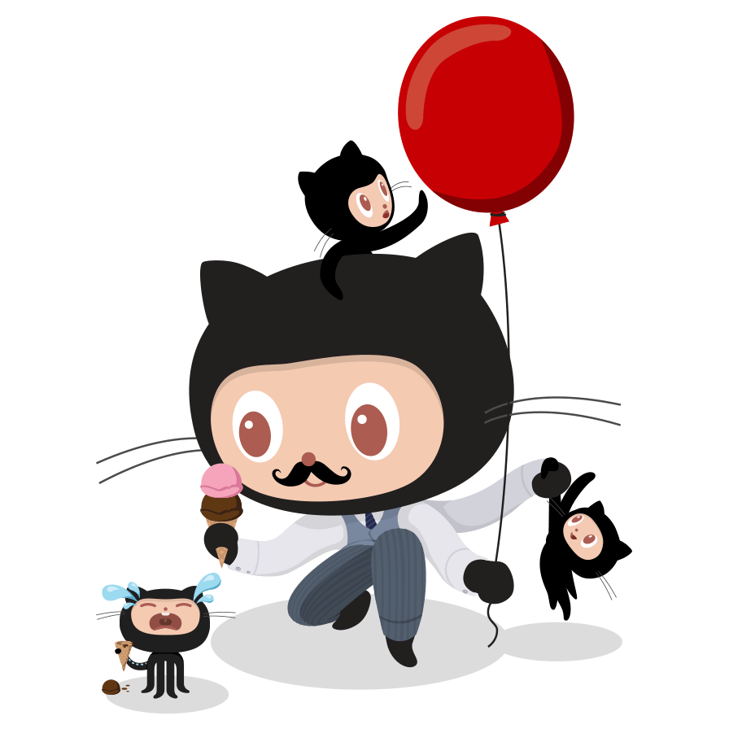

<h1 align="center">Hello 👋, I'm Mohamed Said</h1>
<h3 align="center">🎓 I'm a student passionate about software development and building real-world projects.</h3>

- 📫 How to reach me **mohamedsaid.ghoulam@univ-tiaret.dz**

---

<table>
<tr>
<td width="65%" valign="top">

## 🧠 About Me

- 🎓 Passionate about software development and building real-world projects
- 💻 Focused on becoming a skilled backend developer
- 🔐 Interested in cybersecurity, ethical hacking, and system security
- 📚 Always learning and improving my problem-solving skills
- 🔍 Curious about how systems work — and how to secure them

</td>
<td width="35%" align="center" valign="center">

</td>
</tr>
</table>

---

## 📌 Current Projects

- 🎓 School Management System
- 🔗 REST API development with authentication
- 🧵 Multithreading & synchronization (C/C++)

---

<h3 align="left">Connect with me:</h3>

<h3 align="left">Languages and Tools:</h3>

---

## 🐍 My GitHub Contribution Snake

  <picture>
    <source media="(prefers-color-scheme: dark)"
      srcset="https://raw.githubusercontent.com/MohamedSaid16/MohamedSaid16/output/github-contribution-grid-snake-dark.svg">
    <source media="(prefers-color-scheme: light)"
      srcset="https://raw.githubusercontent.com/MohamedSaid16/MohamedSaid16/output/github-contribution-grid-snake.svg">
    
  </picture>

